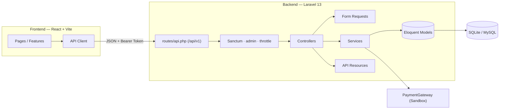
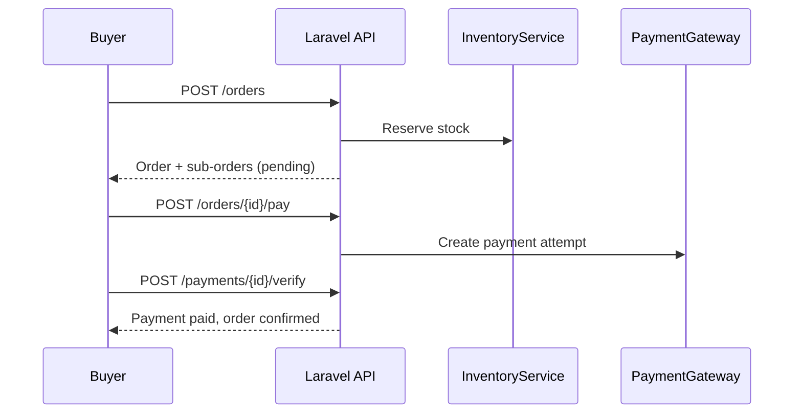

<div align="center">

# 🛒 Smart Marketplace

**بازارگاه چندفروشنده‌ی مدرن؛ فرانت‌اند React 19 و بک‌اند Laravel 13 با ارتباط کامل از طریق REST API**


</div>

---

## ✨ معرفی

Smart Marketplace یک پلتفرم فروشگاهی **چندفروشنده** (Multi-Vendor) است: هر کاربر می‌تواند خریدار باشد، فروشگاه خودش را باز کند و محصول بفروشد، و مدیر سیستم بر کل بازارگاه نظارت کند. سفارش‌ها به‌صورت **زیرسفارش‌های هر فروشنده** مدیریت می‌شوند و موجودی با سیستم **رزرو و آزادسازی خودکار** کنترل می‌شود.

## 🚀 قابلیت‌ها

| حوزه | امکانات |
| --- | --- |
| 🛍️ **فروشگاه** | کاتالوگ محصولات با فیلتر و جست‌وجو، دسته‌بندی و برند، صفحه‌ی جزئیات محصول |
| 🧺 **سبد خرید** | سبد مهمان بدون نیاز به ورود، افزودن، ویرایش تعداد و حذف آیتم |
| 📦 **سفارش و پرداخت** | تسویه، ثبت سفارش، پرداخت دومرحله‌ای (ساخت تلاش + تأیید)، تاریخچه‌ی وضعیت سفارش |
| 👤 **پنل کاربر** `/account` | مشخصات، سفارش‌های من، مدیریت نشانی‌ها، تغییر گذرواژه، فروشنده‌شدن |
| 🏪 **پنل فروشنده** `/vendor` | داشبورد، مدیریت محصولات، موجودی انبار، مدیریت زیرسفارش‌ها و تغییر وضعیت |
| 🛡️ **پنل مدیریت** `/admin` | داشبورد با نمودار درآمد، فروشندگان، کالاها، سفارش‌ها، کاربران، دسته‌بندی‌ها و برندها |
| 🔐 **امنیت** | توکن Sanctum، میدل‌ور نقش مدیر، محدودیت نرخ درخواست، بررسی مالکیت منابع |
| 📉 **موجودی** | رزرو موجودی هنگام سفارش و آزادسازی رزروهای منقضی با زمان‌بند (هر دقیقه) |

## 🧱 معماری



### جریان یک سفارش



## 🛠️ فناوری‌ها

**Frontend**
- React 19، TypeScript 5.9، Vite 7، React Router 7
- Tailwind CSS 4، Motion (انیمیشن)، Lucide (آیکن‌ها)
- ESLint 9 با قواعد React Hooks

**Backend**
- PHP 8.3+، Laravel 13، Laravel Sanctum
- معماری لایه‌ای: Controller ← FormRequest ← Service ← Model ← Resource
- Enumهای نوع‌دار برای نقش، وضعیت سفارش، پرداخت، محصول و فروشنده
- SQLite به‌صورت پیش‌فرض (قابل تعویض با MySQL؛ اسکیمای کامل در `backend/database/schema/smart_marketplace_mysql.sql`)
- تست‌های Feature با PHPUnit 12

## 📁 ساختار پروژه

```text
smart-marketplace/
├── backend/                    # Laravel API
│   ├── app/
│   │   ├── Console/Commands/   # inventory:release-expired
│   │   ├── Contracts/          # PaymentGateway
│   │   ├── Enums/              # UserRole, OrderStatus, ...
│   │   ├── Http/
│   │   │   ├── Controllers/Api/{Admin,Vendor}/
│   │   │   ├── Middleware/     # EnsureUserIsAdmin
│   │   │   ├── Requests/
│   │   │   └── Resources/
│   │   ├── Models/
│   │   └── Services/           # Cart, Order, Payment, Inventory, ...
│   ├── database/               # migrations, factories, seeders
│   ├── routes/api.php
│   └── tests/Feature/
├── frontend/
│   └── src/
│       ├── app/  layouts/  components/ui/  hooks/  types/
│       ├── lib/api/            # کلاینت HTTP مشترک
│       └── features/           # account, admin, auth, cart, home,
│                               # orders, payments, products, vendor
└── docs/
    ├── api.md                  # قرارداد API
    └── erd.md                  # نمودار پایگاه داده
```

هر قابلیت در فرانت‌اند (`features/*`) صفحه‌ها، کانتکست‌ها و توابع API مخصوص خودش را در یک پوشه نگه می‌دارد.

## ⚡ شروع سریع

### پیش‌نیازها

- PHP 8.3+ و Composer
- Node.js و npm

### ۱. بک‌اند

```bash
cd backend
composer install
cp .env.example .env
php artisan key:generate
touch database/database.sqlite      # اگر فایل وجود ندارد
php artisan migrate --seed
php artisan serve                   # http://localhost:8000
```

### ۲. فرانت‌اند

```bash
cd frontend
npm install
cp .env.example .env                # VITE_API_BASE_URL=http://localhost:8000/api/v1
npm run dev                         # http://localhost:5173
```

### ۳. زمان‌بند (توصیه‌شده)

برای آزادسازی خودکار رزروهای منقضی موجودی:

```bash
cd backend
php artisan schedule:work
```

### حساب‌های نمونه (Seeder)

| نقش | ایمیل | رمز |
| --- | --- | --- |
| مدیر | `admin@example.com` | `password` |
| فروشنده | `vendor@example.com` | `password` |
| خریدار | `test@example.com` | `password` |

> ⚠️ این حساب‌ها فقط برای توسعه‌ی محلی هستند و هرگز نباید در محیط عملیاتی seed شوند. Seederها خارج از محیط local و testing اجرا نمی‌شوند.

## ⚙️ متغیرهای محیطی

| فایل | متغیر | توضیح |
| --- | --- | --- |
| `backend/.env` | `APP_URL` | آدرس بک‌اند (پیش‌فرض `http://localhost:8000`) |
| `backend/.env` | `FRONTEND_URLS` | مبداهای مجاز CORS، جداشده با ویرگول |
| `backend/.env` | `DB_CONNECTION` | `sqlite` (پیش‌فرض) یا `mysql` |
| `frontend/.env` | `VITE_API_BASE_URL` | آدرس پایه‌ی API، شامل `/api/v1` |

هیچ کلید محرمانه‌ای در متغیرهای `VITE_*` قرار نگیرد و فایل‌های `.env` وارد مخزن نشوند.

واحد تمام قیمت‌ها **تومان** است (`IRT`). مهاجرت اصلاح واحد پول فقط برچسب سفارش‌های قدیمی را هماهنگ می‌کند و مبلغ‌ها را تغییر نمی‌دهد.

## 🔌 API

آدرس پایه: `/api/v1` — احراز هویت با هدر `Authorization: Bearer <token>`.

| گروه | مسیرها | دسترسی |
| --- | --- | --- |
| احراز هویت | `auth/register` · `auth/login` · `auth/me` · `auth/profile` · `auth/password` · `auth/logout` | عمومی / توکن |
| کاتالوگ | `categories` · `products` (با slug) | عمومی |
| سبد خرید | `cart` · `cart/items` | عمومی |
| نشانی‌ها | `addresses` | توکن |
| سفارش و پرداخت | `orders` · `orders/{id}/pay` · `payments/{id}/verify` | توکن + مالک |
| فروشنده | `vendors/me` · `products` · `inventory` · `orders` | توکن |
| مدیریت | `admin/dashboard` · `vendors` · `products` · `orders` · `users` · `categories` · `brands` | توکن + نقش `admin` |

قالب پاسخ‌ها: موفقیت در `data`، صفحه‌بندی با `links` و `meta`، خطا در `message`، و خطای اعتبارسنجی با وضعیت `422` و جزئیات در `errors`.

📖 مرجع کامل پارامترها، فیلترها و نمونه‌ها: [`docs/api.md`](docs/api.md) — طراحی پایگاه داده: [`docs/erd.md`](docs/erd.md)

## 👥 نقش‌ها و پنل‌ها

فروشندگی یک نوع حساب جدا نیست: **نقش** (`customer` / `vendor` / `admin`) سطح دسترسی را تعیین می‌کند و **داشتن فروشگاه** یعنی فروشنده بودن. بنابراین یک حساب می‌تواند هم‌زمان خریدار، فروشنده و مدیر باشد.

- **فروشنده‌شدن:** خریدار از `/account/store` یا دکمه‌ی «فروشنده شوید» نام فروشگاه را ثبت می‌کند. فروشگاه با وضعیت «در انتظار تأیید» ساخته می‌شود و پس از تأیید مدیر در `/admin/vendors` فعال می‌گردد.
- **لینک‌های هدر:** «پنل مدیریت» برای نقش `admin`، «پنل فروشنده» وقتی فروشگاه وجود دارد، و در غیر این صورت «فروشنده شوید».

## 🧪 تست و کیفیت کد

```bash
# بک‌اند
cd backend
composer test            # یا: php artisan test
./vendor/bin/pint        # قالب‌بندی کد

# فرانت‌اند
cd frontend
npm run test            # Node.js 22.8+
npm run lint
npm run build            # tsc -b && vite build
```

تست‌های Feature شامل احراز هویت، کاتالوگ، سبد خرید، نشانی‌ها، سفارش، پرداخت، موجودی، فروشنده (و فروشنده‌شدن)، پنل مدیریت و اسکیمای دیتابیس هستند.

## 🔒 نکات امنیتی

- 🧪 **درگاه پرداخت فعلی سندباکس است** (`SandboxGateway`): فقط در محیط `local` و `testing` فعال می‌شود، همیشه موفق است و **هیچ پولی جابه‌جا نمی‌کند**. برای محیط واقعی، پیاده‌سازی جدیدی از `App\Contracts\PaymentGateway` جایگزین کنید.
- مجوزدهی و اعتبارسنجی همیشه در بک‌اند اجرا می‌شود؛ فرانت‌اند فقط تجربه‌ی کاربری است.
- مسیرهای ورود و ثبت‌نام محدودیت نرخ دارند و دسترسی به سفارش یا پرداخت کاربر دیگر `404` برمی‌گرداند.
- پیش از استقرار: `APP_DEBUG=false`، تنظیم `FRONTEND_URLS` برای دامنه‌ی واقعی، و حذف حساب‌های seed توسعه.

## 🗺️ نقشه‌ی راه

مدل‌های داده‌ی این موارد در دیتابیس وجود دارد ولی API و رابط کاربری آن‌ها هنوز پیاده‌سازی نشده است:

- [ ] اتصال درگاه پرداخت واقعی
- [ ] بازگشت وجه (Refund) و مرجوعی
- [ ] تسویه‌ی فروشندگان (Payout)
- [ ] نظرات و امتیاز محصولات
- [ ] کوپن تخفیف و روش‌های ارسال
- [x] تست‌های رگرسیون کلاینت API و صف درخواست‌های فرانت‌اند
- [ ] تست‌های مرورگر و CI

## 🤝 مشارکت

1. مخزن را Fork کنید و یک شاخه‌ی جدید بسازید.
2. تغییرات را همراه با تست انجام دهید و `composer test` و `npm run lint` را اجرا کنید.
3. Pull Request با توضیح واضح ارسال کنید.

---

<div align="center">

ساخته‌شده با ❤️ برای یک بازارگاه سریع، امن و توسعه‌پذیر

</div>
